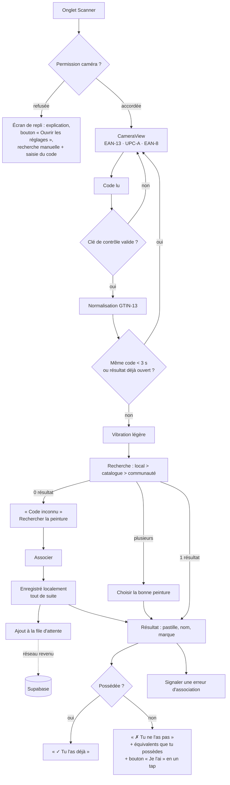

# Pigment — Architecture (proposition à valider)

> Étape 0 : rien n'est codé. Ce document décrit l'organisation prévue et les décisions à trancher (§ 9).
> Il sera mis à jour une fois validé, puis servira de référence pendant le développement.

---

## 1. Principes

1. **Local d'abord.** Tout (catalogue, inventaire, recettes, photos, scan) fonctionne sans réseau.
   Supabase n'est utilisé que pour la base communautaire de codes-barres ; s'il est absent, en panne
   ou mis en pause, l'app continue de tourner normalement.
2. **Logique pure séparée de l'interface.** Couleurs, recherche, équivalences, validation, fusion
   du catalogue, export… vivent dans `lib/` : du TypeScript sans React Native, donc facile à tester.
3. **Accès aux données derrière des interfaces** (« repositories »). Les écrans ne parlent jamais
   directement à SQLite. Ça permettra d'ajouter plus tard une synchro inventaire/recettes sans tout réécrire.
4. **Identifiants stables + horodatages.** Chaque donnée utilisateur a un id UUID, `created_at`,
   `updated_at` et `deleted_at` (suppression « douce », nécessaire pour une future synchro).
5. **Pas de données inventées.** Le catalogue d'exemple est marqué `verified: false` ; un hex peut
   être absent (pastille hachurée « couleur inconnue », exclue des équivalences).

---

## 2. Stack — avis sur les choix imposés

Tous les choix imposés me conviennent. Quelques précisions :

| Choix | Avis |
|---|---|
| Expo + TS strict + Expo Router | ✅ Dernier SDK Expo stable (Nouvelle Architecture), vérifié au moment du squelette. |
| expo-sqlite | ✅ Une seule base `pigment.db` (catalogue + données perso) pour pouvoir filtrer « possédées » par simple jointure. |
| expo-camera `CameraView` | ✅ Attention : sur iPhone, un UPC-A est souvent lu comme un EAN-13 précédé d'un `0`. Tous les codes sont donc **normalisés en GTIN-13** et leur clé de contrôle vérifiée (élimine les mauvaises lectures). |
| i18next + expo-localization | ✅ Les textes de permission iOS sont traduits via `locales` dans `app.json`. Sur Android, ces dialogues sont gérés par le système (pas de texte personnalisé possible). |
| FlashList | ✅ |
| Jest + RNTL | ✅ Pour tester les migrations et les repositories **sur un vrai SQLite** dans Jest, j'ajoute un petit adaptateur `better-sqlite3` (dépendance de dev uniquement) derrière la même interface que expo-sqlite. |
| EAS Build / Update | ✅ `runtimeVersion` en mode `fingerprint` : EAS calcule tout seul si un nouveau build est nécessaire (module natif changé) ou si une simple mise à jour suffit. |
| Supabase | ✅ Attention : un projet **gratuit est mis en pause après 7 jours sans activité**. Sans conséquence pour l'app (local d'abord), mais à savoir : il faudra parfois le « réveiller » depuis le tableau de bord. |

**Bibliothèques que j'ajouterais** (toutes compatibles Expo Go, sauf mention) :

| Besoin | Bibliothèque | Pourquoi |
|---|---|---|
| Archive `.zip` | `fflate` | Pur JavaScript, rapide, fonctionne dans Expo Go et dans Jest. Écriture en flux pour ne pas charger toutes les photos en mémoire. |
| Validation des données | `zod` | Valide le catalogue, les CSV, les sauvegardes importées ; génère les types TS. |
| Lecture CSV (script) | `papaparse` + `tsx` | Pour `scripts/import-catalog.ts`. |
| Fichiers / partage | `expo-file-system`, `expo-sharing`, `expo-document-picker` | Photos, export, import d'une sauvegarde. |
| Photos | `expo-image-picker`, `expo-image-manipulator`, `expo-image` | Ajout, compression, affichage rapide avec cache. |
| Image de partage | `react-native-view-shot` | Capture d'une vue récapitulative en PNG. |
| Retour haptique / écran allumé | `expo-haptics`, `expo-keep-awake` | Vibration au scan, mode atelier. |
| UUID | `expo-crypto` | `randomUUID()`. |
| Réseau | `@react-native-community/netinfo` | Déclenche l'envoi de la file d'attente au retour du réseau. |
| Glisser-déposer | `react-native-reanimated` + `react-native-gesture-handler` + une liste réordonnable | Choix précis de la lib à l'étape 6. Des boutons « Monter / Descendre » restent disponibles (le glisser-déposer n'est pas utilisable au lecteur d'écran). |
| État en mémoire | `zustand` | Minuscule ; garde l'index de recherche et l'ensemble « possédées » en mémoire pour une recherche instantanée. |

---

## 3. Arborescence

```
Pigment/
├─ app/                              # Écrans (Expo Router)
│  ├─ _layout.tsx                    # Fournisseurs : base, i18n, thème ; redirige vers l'onboarding
│  ├─ onboarding.tsx                 # 1er lancement : langue + code de groupe (facultatif, « plus tard »)
│  ├─ (tabs)/
│  │  ├─ _layout.tsx                 # 4 onglets, Scanner au centre et mis en avant
│  │  ├─ index.tsx                   # Inventaire (recherche + filtres + liste)
│  │  ├─ scan.tsx                    # Scanner
│  │  ├─ recipes.tsx                 # Liste des recettes (cartes)
│  │  └─ settings.tsx                # Réglages
│  ├─ paint/[id].tsx                 # Fiche peinture (tons Tone Pro, équivalences, recettes liées)
│  ├─ scan/result.tsx                # Résultat de scan (modal) « ✓ Tu l'as déjà / ✗ Tu ne l'as pas »
│  ├─ scan/associate.tsx             # Code inconnu → associer à une peinture
│  ├─ filters.tsx                    # Feuille de filtres (modal)
│  ├─ recipe/[id]/index.tsx          # Détail recette
│  ├─ recipe/[id]/edit.tsx           # Création / édition
│  ├─ recipe/[id]/workshop.tsx       # Mode atelier
│  ├─ recipe/[id]/share.tsx          # Aperçu + partage de l'image récapitulative
│  └─ settings/                      # about.tsx, backup.tsx, storage.tsx, community.tsx, language.tsx
│
├─ components/
│  ├─ ui/                            # Primitives du thème : Text, Button, Chip, Card, Sheet, ListRow…
│  ├─ paint/                         # Swatch (pastille), PaintRow, OwnedBadge (icône + texte),
│  │                                 # BrandLogo (logo ou badge initiales), ToneLadder, ProximityLabel
│  ├─ recipe/                        # RecipeCard, StepEditor, PaintCoverage (« X/Y »), PhotoGrid
│  └─ scan/                          # ScanResultCard, PermissionFallback
│
├─ lib/                              # 100 % pur, 100 % testé, aucun import React Native
│  ├─ color/                         # hex.ts, lab.ts (hex→sRGB→XYZ D65→CIELAB), ciede2000.ts,
│  │                                 # family.ts (rouges, bleus…), proximity.ts (seuils ΔE → libellé)
│  ├─ equivalence/                   # rank.ts : curated d'abord, compatibilité des types, top 3/marque,
│  │                                 # ton Tone Pro le plus proche, « plus proche possédée »
│  ├─ search/                        # normalize.ts (accents, casse), fuzzy.ts (fautes légères), filters.ts
│  ├─ barcode/                       # gtin.ts (clé de contrôle, UPC-A/EAN-8 → GTIN-13), debounce.ts
│  ├─ catalog/                       # schema.ts (zod), csv.ts (CSV → JSON + validation), merge.ts
│  ├─ community/                     # validation.ts (seuil, signalements), outbox.ts (reprise, backoff)
│  ├─ recipes/                       # coverage.ts (X/Y + manquantes + substituts), duplicate.ts
│  ├─ photos/                        # orphans.ts (fichiers sur disque ↔ chemins en base)
│  └─ backup/                        # format.ts (zod), pack.ts / unpack.ts (zip), merge.ts
│
├─ db/
│  ├─ driver.ts                      # Interface SqlDriver (expo-sqlite en app, better-sqlite3 en test)
│  ├─ migrations/                    # 001_init.ts, 002_….ts — versionnées via PRAGMA user_version
│  ├─ migrate.ts
│  ├─ repositories/                  # Interfaces + implémentations SQLite :
│  │                                 # catalog, inventory, barcodes, recipes, photos, settings, outbox
│  └─ catalogLoader.ts               # Charge le catalogue embarqué ou distant dans les tables
│
├─ services/                         # Effets de bord (fichiers, réseau, caméra), injectés dans l'app
│  ├─ photoStore.ts                  # Compression, miniatures, suppression
│  ├─ backupService.ts               # Export/import .zip via partage système
│  ├─ catalogUpdate.ts               # Vérifie le manifeste distant, télécharge, valide, fusionne
│  ├─ supabase.ts                    # Client + auth anonyme
│  └─ communitySync.ts               # Envoi de la file d'attente + récupération des codes validés
│
├─ state/                            # Stores zustand (index de recherche, possédées, réglages)
├─ hooks/
├─ theme/                            # Jetons (couleurs, espacements, rayons, typo) clair/sombre
├─ i18n/                             # index.ts, locales/fr.json, locales/en.json, native/ (permissions iOS)
├─ catalog/
│  ├─ source/                        # brands.json, ranges.json, paints.csv (tes vraies données)
│  └─ catalog.json                   # Généré par le script (embarqué dans l'app)
├─ assets/
│  ├─ brands/                        # <brandId>.png — fournis par toi
│  ├─ paints/                        # <paintId>.webp — photos de pots facultatives
│  └─ generated/                     # Registre généré des images (Metro ne sait pas faire de require dynamique)
├─ scripts/
│  ├─ import-catalog.ts              # CSV → catalog.json + rapport d'erreurs
│  ├─ gen-asset-registry.ts          # Scanne assets/brands et assets/paints
│  └─ publish-catalog.ts             # Prépare le manifeste pour la mise à jour à distance
├─ supabase/
│  ├─ migrations/                    # Tables, index, RLS, limitation de débit, fonctions
│  └─ README.md
├─ design/                           # Maquettes HTML (étape « idées d'interface »)
├─ docs/                             # ARCHITECTURE.md, INSTALL-AMIS.md
├─ app.json, eas.json, tsconfig.json, jest.config.js, eslint.config.js, .prettierrc
└─ README.md
```

Les tests sont placés à côté du code (`lib/color/ciede2000.test.ts`, etc.).

---

## 4. Catalogue

### 4.1 Format `catalog.json` (embarqué et distant)

```jsonc
{
  "schemaVersion": 1,               // format du fichier (change rarement)
  "version": 3,                     // version des données (incrémentée à chaque publication)
  "generatedAt": "2026-11-06T10:00:00Z",
  "brands":  [{ "id": "vallejo", "name": "Vallejo", "badgeColor": "#…" }],
  "ranges":  [{ "id": "vallejo-game-color", "brandId": "vallejo", "name": "Game Color", "toneCount": null }],
  "paints":  [{
    "id": "vallejo-game-color-72010",   // stable, ne change JAMAIS
    "brandId": "vallejo", "rangeId": "vallejo-game-color",
    "name": "…", "sku": "72.010",
    "type": "layer",                    // énumération fermée, voir ci-dessous
    "hex": "#RRGGBB" | null,            // jamais inventé ; null = inconnu
    "barcodes": ["8429551720106"],      // GTIN-13 normalisés
    "verified": false,
    "family": null, "tone": null,       // Tone Pro : "family": "…", "tone": 1..5
    "discontinued": false
  }],
  "sets": [{ "id": "…", "kind": "triad" | "set", "name": "…", "paintIds": ["…", "…"] }],
  "equivalences": [{ "paintId": "…", "equivalentId": "…", "note": "…" }]   // curated
}
```

- **Types** : `base, layer, shade, contrast, speedpaint, metallic, technical, dry, glaze, primer, texture, ink, air, varnish, other`.
- **Tone Pro** : `ranges.toneCount = 5` ; chaque peinture a `family` + `tone` (1 = plus foncé, 5 = plus clair).
  Le script vérifie que chaque famille a exactement ses 5 tons. `family`/`tone` décrivent une
  **échelle de tons propre à la gamme** (1 peinture = 1 place) ; `sets` décrit les **regroupements
  commerciaux** (triades Scale75, sets Kimera…), où une peinture peut apparaître dans plusieurs sets.
- Taille estimée : ~3 000 peintures × ~220 octets ≈ 650 Ko (≈ 120 Ko compressé en transit).

### 4.2 Script d'import `scripts/import-catalog.ts`

`npm run catalog:import` lit `catalog/source/*.csv|json`, valide, écrit `catalog/catalog.json` et
affiche un rapport. Erreurs bloquantes : champ obligatoire manquant, id en double, hex invalide,
type inconnu, marque/gamme inconnue, **clé de contrôle de code-barres fausse**, même code-barres
sur deux peintures, ton hors limites ou famille incomplète. Avertissements : peinture présente dans
la version précédente mais disparue (un id qui disparaît casse des inventaires), `verified: false`.

### 4.3 Mise à jour à distance

1. Un petit `manifest.json` public (`{ version, url, sha256, minSchemaVersion }`) est hébergé
   (voir décision n° 2).
2. Au lancement (au plus une fois par jour, si réseau) l'app compare `version`, télécharge,
   vérifie le `sha256` et le schéma zod, puis fusionne **dans une transaction**.
3. Règles de fusion (`lib/catalog/merge.ts`, testé) :
   - peinture nouvelle ou modifiée → mise à jour ;
   - peinture disparue → supprimée si personne ne s'en sert, sinon marquée `removed` (masquée de la
     recherche, mais l'inventaire l'affiche avec la mention « retirée du catalogue ») ;
   - codes-barres `catalog` remplacés ; codes `local` (tes associations) et `community` conservés.
4. En cas d'échec, l'ancien catalogue reste en place.

---

## 5. Schéma de la base SQLite (`pigment.db`)

### 5.1 Catalogue (remplacé lors des mises à jour)

```sql
CREATE TABLE brands (
  id TEXT PRIMARY KEY, name TEXT NOT NULL, badge_color TEXT, sort INTEGER NOT NULL DEFAULT 0
);
CREATE TABLE ranges (
  id TEXT PRIMARY KEY, brand_id TEXT NOT NULL REFERENCES brands(id),
  name TEXT NOT NULL, tone_count INTEGER, sort INTEGER NOT NULL DEFAULT 0
);
CREATE TABLE paints (
  id TEXT PRIMARY KEY,
  brand_id TEXT NOT NULL, range_id TEXT NOT NULL,
  name TEXT NOT NULL,
  name_norm TEXT NOT NULL,            -- minuscules, sans accents (recherche)
  sku TEXT,
  type TEXT NOT NULL,
  hex TEXT,                           -- NULL = couleur inconnue
  lab_l REAL, lab_a REAL, lab_b REAL, -- précalculés au chargement
  color_family TEXT,                  -- 'red','blue','green','brown','grey','metal'…
  family TEXT, tone INTEGER,
  verified INTEGER NOT NULL DEFAULT 0,
  discontinued INTEGER NOT NULL DEFAULT 0,
  removed INTEGER NOT NULL DEFAULT 0
);
CREATE INDEX idx_paints_range        ON paints(brand_id, range_id);
CREATE INDEX idx_paints_type         ON paints(type);
CREATE INDEX idx_paints_color_family ON paints(color_family);
CREATE INDEX idx_paints_tone         ON paints(range_id, family, tone);

CREATE TABLE paint_sets (id TEXT PRIMARY KEY, brand_id TEXT, range_id TEXT, kind TEXT NOT NULL, name TEXT NOT NULL);
CREATE TABLE paint_set_members (
  set_id TEXT NOT NULL, paint_id TEXT NOT NULL, position INTEGER NOT NULL,
  PRIMARY KEY (set_id, paint_id)
);
CREATE TABLE curated_equivalences (
  paint_id TEXT NOT NULL, equivalent_id TEXT NOT NULL, note TEXT,
  PRIMARY KEY (paint_id, equivalent_id)
);
CREATE TABLE catalog_meta (key TEXT PRIMARY KEY, value TEXT NOT NULL);  -- version, source, last_check
```

### 5.2 Codes-barres (trois origines)

```sql
CREATE TABLE barcodes (
  code TEXT NOT NULL,                 -- GTIN-13 normalisé
  paint_id TEXT NOT NULL,
  source TEXT NOT NULL CHECK (source IN ('catalog','community','local')),
  created_at TEXT NOT NULL, updated_at TEXT NOT NULL,
  PRIMARY KEY (code, paint_id, source)
);
CREATE INDEX idx_barcodes_code ON barcodes(code);
```
Priorité à la lecture : `local` > `catalog` > `community`. Si un code correspond à plusieurs
peintures, l'app propose de choisir.

### 5.3 Données personnelles (synchronisables plus tard)

```sql
CREATE TABLE inventory (
  paint_id TEXT PRIMARY KEY,          -- id stable du catalogue
  owned INTEGER NOT NULL DEFAULT 0,
  notes TEXT,                         -- conservées même si non possédée
  updated_at TEXT NOT NULL, deleted_at TEXT
);
CREATE INDEX idx_inventory_owned ON inventory(owned);

CREATE TABLE recipes (
  id TEXT PRIMARY KEY,                -- UUID
  title TEXT NOT NULL, title_norm TEXT NOT NULL,
  description TEXT, favorite INTEGER NOT NULL DEFAULT 0,
  cover_photo_id TEXT,
  duplicated_from TEXT,               -- variante d'une autre recette
  remote_id TEXT,                     -- réservé : future base communautaire de recettes
  created_at TEXT NOT NULL, updated_at TEXT NOT NULL, deleted_at TEXT
);
CREATE TABLE recipe_tags (
  recipe_id TEXT NOT NULL, tag TEXT NOT NULL, tag_norm TEXT NOT NULL,
  PRIMARY KEY (recipe_id, tag_norm)
);
CREATE INDEX idx_recipe_tags_norm ON recipe_tags(tag_norm);

CREATE TABLE recipe_steps (
  id TEXT PRIMARY KEY, recipe_id TEXT NOT NULL, position INTEGER NOT NULL,
  technique TEXT,                     -- clé de la liste ('basecoat','wash','drybrush'…) ou NULL
  technique_custom TEXT,              -- saisie libre
  dilution TEXT, tool TEXT, note TEXT,
  created_at TEXT NOT NULL, updated_at TEXT NOT NULL, deleted_at TEXT
);
CREATE INDEX idx_steps_recipe ON recipe_steps(recipe_id, position);

CREATE TABLE recipe_step_paints (
  id TEXT PRIMARY KEY, step_id TEXT NOT NULL, position INTEGER NOT NULL,
  paint_id TEXT,                      -- NULL si peinture libre (hors catalogue)
  ratio_part REAL,                    -- ex. 2 et 1 → affiché « 2:1 »
  snapshot_name TEXT NOT NULL,        -- copie au moment de l'ajout :
  snapshot_brand TEXT,                -- la recette reste lisible si la peinture
  snapshot_hex TEXT,                  -- disparaît du catalogue
  updated_at TEXT NOT NULL
);
CREATE INDEX idx_step_paints_paint ON recipe_step_paints(paint_id);   -- « recettes qui l'utilisent »

CREATE TABLE photos (
  id TEXT PRIMARY KEY,
  recipe_id TEXT NOT NULL,
  step_id TEXT,                       -- NULL = galerie de la recette
  position INTEGER NOT NULL,
  file_name TEXT NOT NULL,            -- relatif à documentDirectory/photos/ (jamais de base64)
  thumb_file_name TEXT NOT NULL,
  width INTEGER, height INTEGER, bytes INTEGER,
  created_at TEXT NOT NULL, updated_at TEXT NOT NULL
);
CREATE INDEX idx_photos_owner ON photos(recipe_id, step_id, position);
```

### 5.4 Technique

```sql
CREATE TABLE settings (key TEXT PRIMARY KEY, value TEXT NOT NULL);   -- langue, qualité photo, code de groupe…
CREATE TABLE outbox (                                               -- file d'attente hors ligne
  id TEXT PRIMARY KEY, kind TEXT NOT NULL, payload TEXT NOT NULL,
  created_at TEXT NOT NULL, attempts INTEGER NOT NULL DEFAULT 0,
  next_attempt_at TEXT, last_error TEXT
);
```

Migrations : `PRAGMA user_version` + fichiers `db/migrations/NNN_*.ts` exécutés dans l'ordre,
chacun dans une transaction. Testées sur une base vide **et** sur une base de la version précédente.

---

## 6. Flux du scan



Le badge combine toujours **icône + texte + couleur** (jamais la couleur seule) et est annoncé
au lecteur d'écran.

---

## 7. Équivalences (`lib/color`, `lib/equivalence`)

- hex → sRGB linéaire → XYZ (D65) → CIELAB ; distance **CIEDE2000** (tests avec les 34 paires de
  référence publiées par Sharma, Wu & Dalal, 2005).
- **Libellés de proximité** (seuils proposés, réglables en un seul endroit) :

  | ΔE00 | Libellé |
  |---|---|
  | < 2 | Quasi identique |
  | 2 – 5 | Très proche |
  | 5 – 10 | Proche |
  | 10 – 20 | Approximatif |
  | > 20 | non proposé |

  Ces seuils sont plus larges que les seuils « de laboratoire » parce que les hex des peintures
  sont eux-mêmes approximatifs (photo du pot, rendu écran…).
- **Compatibilité des types** (règle dure + pénalité) :

  | Groupe | Types | Peut être proposé pour… |
  |---|---|---|
  | Opaque | base, layer, air, dry | opaque (pénalité nulle) ; contrast (+ pénalité) |
  | Transparent | shade, ink, glaze | même groupe (pénalité légère entre types) |
  | Contrast | contrast, speedpaint | contrast/speedpaint ; opaque (+ pénalité) |
  | Métal | metallic | **métal uniquement**, et un métal n'est jamais proposé pour une couleur mate |
  | Spéciaux | technical, texture, primer, varnish | même type uniquement |

  Score = ΔE00 + pénalité de type. Les **équivalences curated passent toujours en premier**
  (« Équivalence reconnue »), puis le calcul automatique. Top 3 par autre marque, avec indication
  « possédée ».
- **Tone Pro** : pour une peinture d'une autre marque, l'app affiche aussi le ton Tone Pro le plus
  proche (« Famille X, ton 3 ») ; la fiche d'une peinture Tone Pro affiche ses 5 tons côte à côte.
- Performance : ~3 000 calculs CIEDE2000 par fiche, quelques millisecondes ; aucun précalcul nécessaire
  (le LAB, lui, est précalculé en base).
- **Famille de couleur** (filtre) : calculée depuis L\*, C\*, h° : faible chroma → noirs/gris/blancs ;
  sinon par angle de teinte (rouges, oranges, jaunes, verts, bleus, violets, roses) ; les tons
  orange/rouge sombres et peu saturés → bruns ; type `metallic` → métalliques.

---

## 8. Autres flux

### 8.1 Recherche
Index en mémoire construit au démarrage (≈ 3 000 entrées). Normalisation (accents, casse,
ponctuation) ; correspondance par préfixe > sous-chaîne > distance d'édition (1 faute pour les
mots ≥ 4 lettres, 2 pour ≥ 8). Cherche aussi dans le SKU et le code-barres. Filtres combinables
appliqués sur le même index ; FlashList pour l'affichage.

### 8.2 Recettes
- « Tu as X/Y peintures » : `lib/recipes/coverage.ts` compte les peintures distinctes de toutes les
  étapes (une peinture libre hors catalogue compte comme « non vérifiable »), liste les manquantes et
  propose pour chacune la plus proche possédée (module d'équivalences).
- Filtre « réalisable avec mes peintures » = couverture complète.
- Mode atelier : une étape par écran, texte large, `expo-keep-awake`, navigation par grands boutons.
- Image de partage : vue dédiée rendue hors écran puis capturée (`react-native-view-shot`) → PNG → partage.

### 8.3 Photos
`documentDirectory/photos/<uuid>.jpg` + `<uuid>_thumb.jpg`. Compression à l'ajout (1600 px max,
JPEG 0,7 ; mode « économie » : 1200 px, 0,6 ; miniature 300 px). Suppression des fichiers dans la
même opération que la ligne en base, plus un **nettoyage de sécurité** au démarrage :
`orphans.ts` compare les fichiers présents sur disque aux chemins référencés.

### 8.4 Sauvegarde `.zip`
```
pigment-backup-2026-11-06.zip
├─ backup.json      # { formatVersion, exportedAt, appVersion, inventory, recipes, steps,
│                   #   stepPaints, tags, photos (métadonnées), localBarcodes, settings choisis }
└─ photos/<uuid>.jpg (+ miniatures)
```
Export léger : même `backup.json` sans le dossier `photos/`. Import : validation zod, puis
**fusion** (le plus récent `updated_at` gagne) ou **remplacement** après confirmation (décision n° 3).
Test aller-retour : export → import dans une base vide → contenu identique.

### 8.5 Base communautaire (Supabase)

```sql
groups              (id uuid, name, code_hash)                    -- code hashé (pgcrypto)
group_members       (user_id, group_id, joined_at)
barcode_submissions (id, group_id, barcode, paint_id, user_id, created_at,
                     UNIQUE (user_id, barcode, paint_id))
barcode_reports     (id, group_id, barcode, paint_id, user_id, reason, created_at)
community_config    (group_id, validation_threshold int DEFAULT 2)
validated_barcodes  -- vue : utilisateurs distincts ≥ seuil ET signalements distincts < seuil
```
- Auth anonyme Supabase (aucun compte). Au premier lancement, la saisie du code de groupe appelle
  une fonction `join_group(code)` (SECURITY DEFINER) qui ajoute l'utilisateur anonyme au groupe ;
  **RLS** : lecture/écriture réservées aux membres du groupe, chacun ne peut insérer qu'en son nom.
- Limitation de débit par déclencheurs : p. ex. 60 soumissions/heure par utilisateur, et 5 essais de
  code de groupe ratés/heure (contre la devinette du code).
- Récupération : au plus une fois par jour, l'app télécharge **toute** la liste validée (petite) et
  remplace les codes `community` locaux — ce qui gère aussi les associations invalidées par des signalements.
- La logique « validé / pas validé » existe en double : SQL côté serveur, et `lib/community/validation.ts`
  testé, qui sert de référence.
- Limite connue : réinstaller l'app crée un nouvel id anonyme, donc une personne pourrait « valider »
  seule. Acceptable entre amis.

### 8.6 Future synchro inventaire/recettes (non codée en V1)
Déjà prévu : repositories abstraits, UUID, `updated_at`/`deleted_at` partout, `outbox` générique.
Il suffira d'ajouter des tables miroir côté Supabase et un `syncService` « le plus récent gagne »,
plus le téléversement des photos vers Supabase Storage.

---

## 9. Points à trancher

| # | Question | Ma recommandation |
|---|---|---|
| 1 | Bundle id `com.<monnom>.pigment` et nom du compte Expo (`owner`) | Me donner `<monnom>` ; je mets un provisoire `com.example.pigment` en attendant. |
| 2 | Où héberger le catalogue distant ? | **Supabase Storage** (bucket public, déjà dans la stack). Alternative : fichier sur GitHub Pages. EAS Update peut aussi livrer un nouveau catalogue embarqué. |
| 3 | Import d'une sauvegarde : fusion ou remplacement ? | Proposer **les deux** à l'import, fusion par défaut. |
| 4 | Peintures « libres » dans une recette (hors catalogue : mélange maison, marque absente) | **Oui** : nom + hex facultatif, comptées à part dans X/Y. |
| 5 | Peintures perso ajoutées au catalogue par l'utilisateur | **Non en V1** (le CSV reste la source) ; facile à ajouter plus tard. |
| 6 | Seuils ΔE et matrice de types (§ 7) | Valider ou ajuster. |
| 7 | Signalements : combien pour invalider une association ? | Même seuil que la validation (2 personnes distinctes). |
| 8 | Format des logos | **PNG transparent ~256 px** (SVG demanderait une lib en plus). Nom : `assets/brands/<brandId>.png`. |
| 9 | iOS : ad hoc ou TestFlight ? | Détails ci-dessous ; décision possible à l'étape 8. |
| 10 | Tester sur téléphone | **Expo Go** pour les étapes 1 à 7 (tout est compatible) ; development build à l'étape 8. Note : Expo Go (App Store / Play Store) ne supporte que le dernier SDK. |

### Distribution iOS : les deux options

**Ad hoc (EAS internal distribution)**
- Chaque ami ouvre un lien `eas device:create` sur son iPhone → son appareil est enregistré (UDID).
- Tu lances un build ; EAS génère un profil incluant ces appareils ; tes amis installent via un lien.
- ✅ Pas de revue Apple, pas d'expiration à 90 jours (profil valable ~1 an).
- ❌ Chaque **nouvel** iPhone impose un **nouveau build** ; 100 iPhone max par an ; iOS 16+ demande
  d'activer le « Mode développeur » sur le téléphone.

**TestFlight**
- `eas build` + `eas submit` envoient l'app sur App Store Connect.
- *Testeurs internes* (jusqu'à 100) : membres de ton équipe App Store Connect, **sans revue**.
  Il faut inviter chaque ami dans ton équipe avec un Apple ID.
- *Testeurs externes* (lien public) : plus simple pour les amis, mais **revue « bêta » d'Apple**
  pour le premier build de chaque version — risque de remarque sur les logos de marques tierces.
- ✅ Ajouter un ami ne demande pas de rebuild ; installation via l'app TestFlight.
- ❌ Chaque build **expire après 90 jours** (il faut en renvoyer un).

**EAS Update** fonctionne pareil dans les deux cas. Pour un petit groupe stable, je recommande
**l'ad hoc** (pas de revue, pas d'expiration) ; si le groupe grandit souvent, TestFlight interne.

---

## 10. Ce qu'il faudra installer ou créer, et quand

Rien n'est nécessaire pour l'instant. Choix par défaut retenus : les recommandations du § 9.

| Quand | Quoi | Coût |
|---|---|---|
| Étape 1 (pour essayer l'app) | Sur l'ordinateur : **Node.js LTS** et **Git** (ou GitHub Desktop), puis récupérer le projet | Gratuit |
| Étape 1 | Sur le téléphone : l'app **Expo Go** (App Store / Play Store) | Gratuit |
| Étape 2 ou plus tard | Tes vraies données de peintures, au format du modèle CSV fourni | — |
| Étape 7 | Un compte **Supabase** (projet gratuit) ; le README expliquera chaque clic | Gratuit |
| Étape 8 | Un compte **Expo** (expo.dev) pour EAS Build / Update | Gratuit (offre de base) |
| Étape 8, iPhone uniquement | Un compte **Apple Developer** | 99 $/an |
| Étape 8 | Les logos des marques dans `assets/brands/` | — |

Le bundle id reste `com.example.pigment` jusqu'à l'étape 8. Il peut changer librement jusqu'au
premier build iOS, mais plus ensuite.

## 11. Vérification à chaque étape

Depuis cet environnement (cloud, sans téléphone) je peux vérifier : `tsc --noEmit`, ESLint, Jest,
et le **bundling complet** iOS/Android (`expo export`), ce qui attrape la majorité des erreurs de
lancement. Le test sur téléphone se fait chez toi avec Expo Go (`npx expo start`, scanner le QR code) ;
chaque fin d'étape listera précisément quoi essayer.
